# Clozed MCQ

An Anki cloze note type with optional multiple choice behind each blank.

Every card starts as a normal cloze: recall first. A blank that has choices behind it is orange and glows softly. Tap it (or press Tab) and its choices appear; pick one and the blank fills in. Flip without tapping anything and the card is plain recall, exactly like Anki's own cloze.

Companion to [True-Anki-MCQ-Note-Template](https://github.com/anki-boi/True-Anki-MCQ-Note-Template).

> **Status: early.** The templates are tested in the preview harness in this repo, which copies Anki's cloze output. They have not been tested inside Anki desktop, AnkiMobile or AnkiDroid yet.

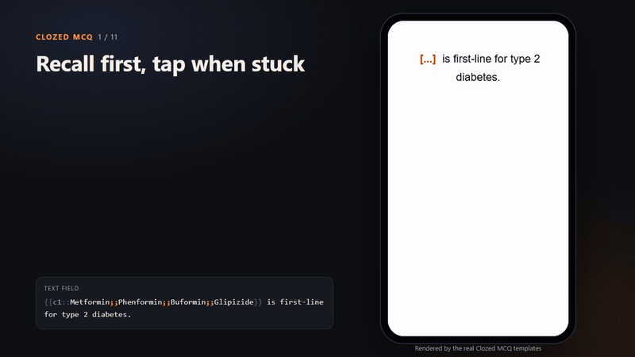

## See it in action

Every clip is recorded from the real templates in this repo. Full walkthrough: [`demos/videos/all-features.mp4`](demos/videos/all-features.mp4) (2 min 23 s).

<details><summary><b>Wrong picks stay visible</b></summary>

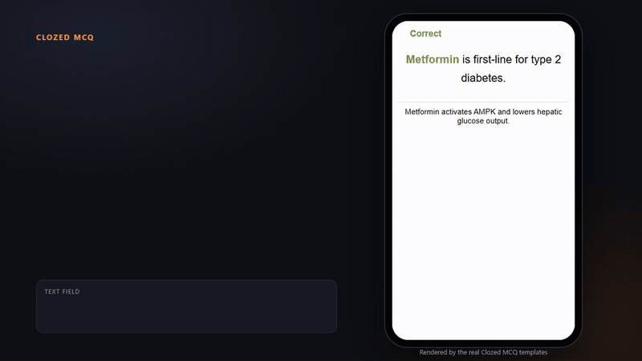
</details>

<details><summary><b>Write choices inside the cloze with ;;</b></summary>

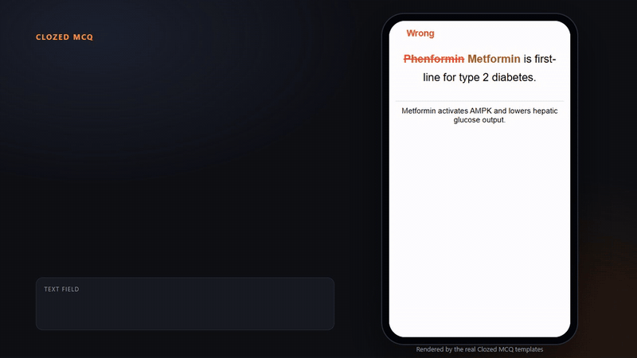
</details>

<details><summary><b>Nested clozes</b></summary>

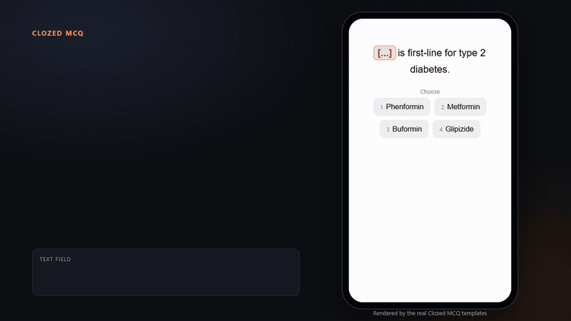
</details>

<details><summary><b>Every blank graded on its own</b></summary>

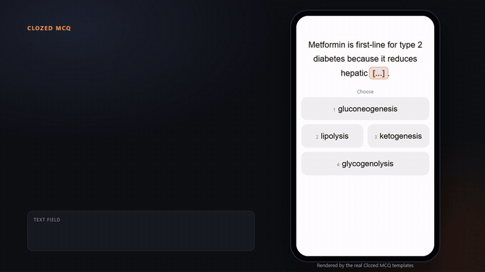
</details>

<details><summary><b>Recall some blanks, pick others</b></summary>

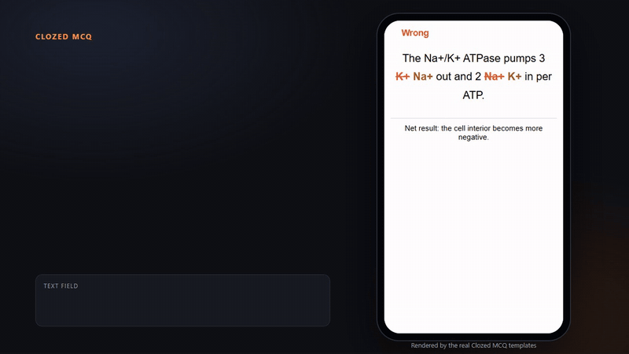
</details>

<details><summary><b>No lists? Blanks borrow each other</b></summary>

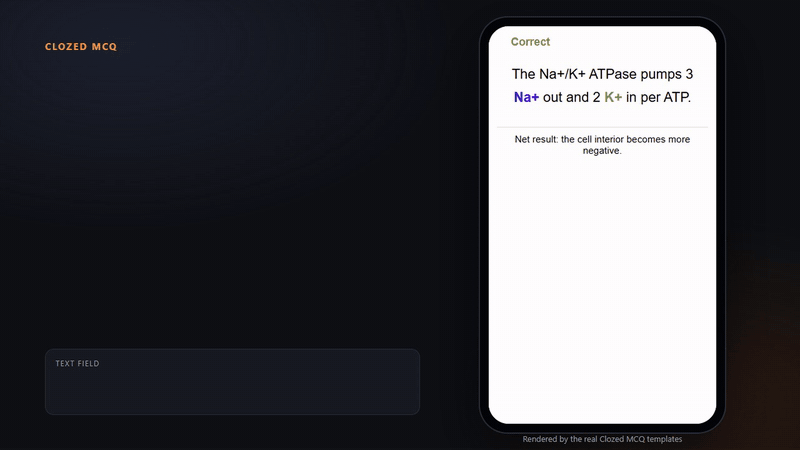
</details>

<details><summary><b>Your old clozes still work</b></summary>

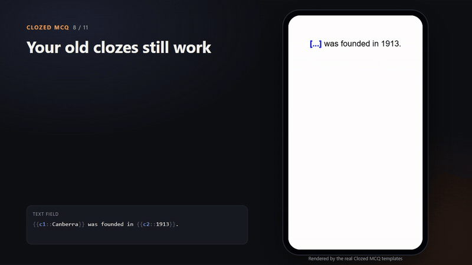
</details>

<details><summary><b>Keyboard</b></summary>

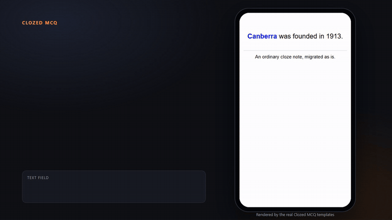
</details>

<details><summary><b>Every AnKing field, AnKing-style buttons</b></summary>

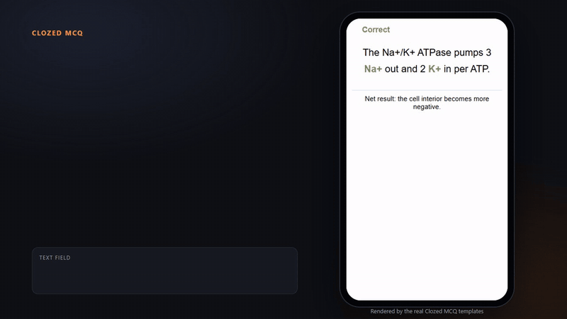
</details>

<details><summary><b>Night mode</b></summary>

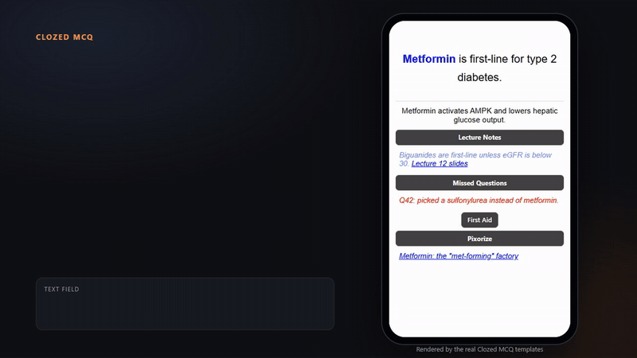
</details>

## Writing choices

Put the distractors inside the cloze, after the answer, separated by `;;`:

```
{{c1::Metformin;;Phenformin;;Buformin;;Glipizide}} is first-line for type 2 diabetes.
```

The first item is the answer. Everything after a `;;` is a distractor. Choices are shuffled on every review.

| You write | What happens |
|---|---|
| `{{c1::Metformin;;Phenformin;;Buformin}}` | Blank with three choices |
| `{{c1::Metformin;;Phenformin::biguanide}}` | Hint goes after the list and shows as `[biguanide]` |
| `{{c1::Canberra}}` | No list: a plain cloze blank |
| `{{c1::Na+;;K+}} out and {{c1::K+;;Na+}} in` | Same number twice: each blank has its own choices and its own grade |
| `{{c1::hexokinase}} ... {{c1::phosphofructokinase-1}}` | Several blanks, no lists: each blank borrows the other answers on the card |

### Nested clozes

A `;;` list belongs to the cloze whose own text it sits in. Put it at the end, after any nested cloze has closed:

```
{{c2::reduces hepatic {{c3::gluconeogenesis;;glycogenolysis;;lipolysis}};;increases insulin release;;slows gastric emptying}}
```

- Card c3 asks for `gluconeogenesis` with its own three choices.
- Card c2 asks for the whole phrase `reduces hepatic gluconeogenesis`. Its distractors are phrases too.
- Each card strips the other clozes' lists, so distractors never leak into the sentence.

### Do not use `|` as a separator

`;;` is used because the AI batch importer writes pipe-delimited rows, and a `|` inside the Text column would shift the columns.

## Grading

Only blanks you picked from are graded on the back:

- Any wrong pick: **Wrong**, with your pick struck through next to the right answer.
- Every pick right: **Correct**, even if you recalled other blanks yourself.
- Nothing picked: no verdict. Grade yourself as on any cloze card.

## Keys

| Key | Action |
|---|---|
| Tab, Right arrow, C, Q | Open the next blank's choices |
| Shift+Tab, Left arrow | Open the previous blank's choices |
| 1 to 9 | Pick a choice |
| Esc | Close the choices |

The keys are set at the top of the front template script. Anki desktop binds 1 to 4 for answering; whether those reach the card on the question side still needs testing.

## Install

**Import the deck (recommended).** Download [`Clozed-MCQ.apkg`](https://github.com/anki-boi/Clozed-MCQ/raw/main/dist/Clozed-MCQ.apkg) and open it with Anki (**File > Import**). You get the `Clozed MCQ` note type with every field set up, plus a small `Clozed MCQ Examples` deck to try. Delete the example deck whenever you like; the note type stays.

**Or paste the templates by hand.** Clone **Cloze** under **Tools > Manage Note Types > Add**, add the fields listed below in the same order, then under **Cards...** paste [`front.html`](front.html), [`back.html`](back.html) and [`styling.css`](styling.css) into Front Template, Back Template and Styling.

## Fields

| Field | Shown |
|---|---|
| Text | The cloze sentence, with `;;` choice lists |
| Back Extra | Under the answer, always |
| Lecture Notes, Missed Questions, Pathoma, Boards and Beyond, First Aid, Sketchy, Sketchy 2, Sketchy Extra, Picmonic, Pixorize, Physeo, Bootcamp, OME, Additional Resources | As buttons on the back, only when the field has content |
| Netters, Robbins, Atlas, Step Up to Medicine, UWorld, Other Reference | As buttons on the back, only when the field has content |
| One by one | Not shown. Kept so AnKing notes keep the value when migrated |
| Note ID | Not shown. Kept so decks that track notes by ID keep it when migrated |

`Text` stays the first field, so Anki's duplicate check and Browse sorting work on the cloze text. If a deck you migrate from had `Note ID` first and its maintainer updates notes by CSV import, those updates matched on the first field; keep that in mind before importing their updates into this note type.

The resource fields copy the names and behaviour of the [AnKing note type](https://github.com/AnKingMed/AnKing-Note-Types). Each one is a button that opens in place and shows the field exactly as written, so links, images and formatting come through as they do in AnKing.

The back template's settings use AnKing's names, so you can copy yours across:

| Setting | Default |
|---|---|
| `ButtonShortcuts` | Alt+1 Lecture Notes, Alt+2 Missed Questions, Alt+3 Pathoma, Alt+4 Boards and Beyond, Alt+5 First Aid, Alt+6 Sketchy, Alt+7 Pixorize, Alt+8 Physeo, Alt+9 Additional Resources, Alt+F1 OME, Alt+F2 Bootcamp |
| `ToggleAllButtonsShortcut` | `'` |
| `ToggleNextButtonShortcut` | `H` |
| `ButtonAutoReveal` | all off; a tag like `autoopen::lecture_notes` opens a field on one note |
| `ScrollToButton` | on |

Not carried over from AnKing: the tag-based "Boards and Beyond Links" and "First Aid Links" buttons, the one-by-one reveal, and click-to-edit fields.

## Migrating existing cloze notes

**Browse > select notes > Notes > Change Note Type > Clozed MCQ.** Anki matches fields by name first, then pairs any leftover old fields with the remaining new fields in order. Cards and review history carry over because both are cloze types. Migrated notes behave as plain cloze cards until you add `;;` lists.

| From | What happens |
|---|---|
| Anki Cloze | Text and Back Extra match by name |
| AnKingOverhaul, older AnKing versions | Every field matches by name; Extra lands in Back Extra |
| Reference-style decks (Note ID, Extra, First Aid, Netters, Robbins, Atlas, Step Up to Medicine, UWorld, Other Reference) | Every field matches by name; Extra lands in Back Extra |
| Cloze Overlapper | Check the dialog: map Original to Text and Remarks to Back Extra |
| Enhanced Cloze | Check the dialog: map the content field to Text |

Any old field the dialog leaves unmapped is deleted, so look over the mapping before you confirm. Changing note type forces a one-way sync.

## Known limits

- Type-in cloze (`{{type:cloze:Text}}`) is not supported: Anki would compare your typing against the whole `;;` list.
- `{{tts ...:cloze-only:Text}}` reads the distractors aloud.
- Places that do not run scripts show the raw `;;` text: the Browse table columns, Card Info and plain-text exports.
- Tapping a blank on AnkiMobile or AnkiDroid may also trigger the app's tap gestures. Not tested yet.
- Image Occlusion notes are not supported.

## Developing

Edit the files in `src/` and `styling.css`, then run:

```bash
python build.py
```

This writes `front.html`, `back.html`, `dist/Clozed-MCQ.apkg` (needs `pip install genanki`) and `preview/preview.html`. The field list lives in `build.py`, and the build stops if a template names a field the note type does not have. Open the preview in a browser to try the templates against sample notes, switch cards, flip sides, and toggle night mode and phone width. It behaves like Anki desktop: one page, card HTML swapped in, scripts re-run.

`samples/cloze-render-samples.html` is the design exploration that led to this behaviour.

### Demo videos

The clips in `demos/` come from `demos/stage.html`, which runs the built templates inside a phone frame with captions. Each feature is a scripted scene in `demos/stage.src.html`. To re-record after a change:

```bash
python build.py
node demos/record.mjs
```

This needs Chrome (or Chromium) and ffmpeg, and no npm packages. Pass scene names to record only those, for example `node demos/record.mjs nested keyboard`. Open `demos/stage.html` in a browser and press Space to watch the scenes live.

## Acknowledgements

Uses [anki-persistence](https://github.com/SimonLammer/anki-persistence) by Simon Lammer (MIT) to carry picks from the front to the back.

## License

MIT. See [LICENSE](LICENSE).
